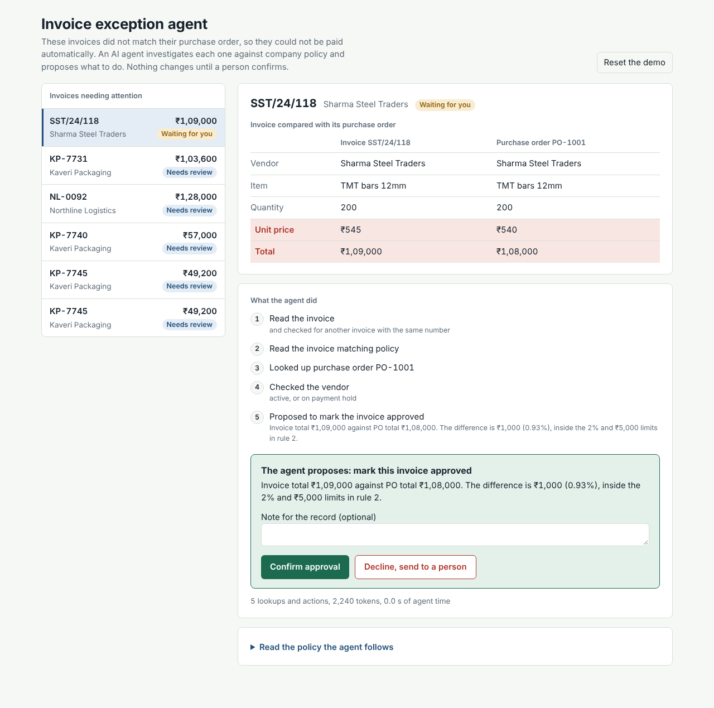

# Invoice exception agent

Invoices that fail purchase-order matching usually get dumped on someone in accounts
payable. This service gives each one to an LLM agent that looks up the invoice, the PO
and the vendor, checks the matching policy, and then approves, rejects or escalates.
Approvals and rejections wait for a person to confirm before anything is written.

**Live demo:** _add your link here_

## How it works

- `tools.py`  the six things the agent may do: four lookups, resolve, escalate. It never runs SQL of its own.
- `agent.py`  a LangGraph loop: model -> tools -> model, until the agent is done.
- `main.py`   the API, the web page, and a log of every run (steps, tokens, latency).
- `policy.md` the rules, in plain English. Changing a rule means editing this file.
- `schema.sql` tables plus six sample invoices, one for each rule in the policy.

`resolve_invoice` calls LangGraph's `interrupt()`, which stops the run and saves it to
Postgres. `POST /runs/{id}/decision` resumes it with the reviewer's answer, so a pending
approval survives a server restart. If the reviewer declines, the agent escalates.

## Run locally

    docker compose up -d                 # Postgres on port 5433
    pip install -r requirements.txt
    set GOOGLE_API_KEY=your-key          # PowerShell: $env:GOOGLE_API_KEY="..."  macOS/Linux: export
    uvicorn main:app --reload

Open http://localhost:8000. The tables are created on first start. "Reset the demo" puts
the six invoices back. The raw API is at http://localhost:8000/docs.

No Docker? Point `DATABASE_URL` at any Postgres instead, for example a free one from neon.tech.

## Deploy

`render.yaml` is a Render blueprint. Create a Postgres database (Render or Neon), then set
`DATABASE_URL` and `GOOGLE_API_KEY` when Render asks for them.

## Tests

    pytest -q

They use a scripted model in place of Gemini, so they need the database but no API key.

## Limits

- One request runs the whole agent, so the page waits 5-20 seconds for a decision.
- Anyone who can open the page can approve or reset; there are no user accounts.
- No evaluation set yet for how often the agent picks the right outcome.
